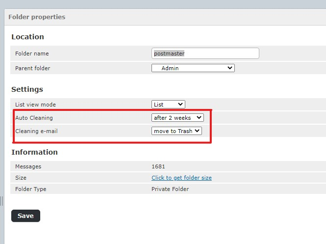

# Autoclean plugin

**Autoclean** is a **Roundcube** plugin, that allows the user to configure automatic cleaning of old messages from folders.

## Screenshot


## Requirements
* Roundcube
* dovecot - server IMAP
* permissions to run **doveadm** 
* access to **cron**

## Installation
Please follow these steps and adapt them to your distribution if necessary

1. Place this plugin folder into plugins directory of Roundcube
2. You can do so either by using `composer`, for which there is `composer.json`, still you need to follow further installation steps, since those could not be accomplished with `composer`
3. After that you need to enable newly installed plugin by adding it 
to **Roundcube** plugin list. For **Debian** the related config file is `_ROUNDCUBE_FOLDER_/config/config.inc.php` and relevant setting are 
	```php
		$rcmail_config ['plugins'] = array();
	```
    Appending `, 'autoclean'` to the list of plugins will suffice.
4. You can use crontab to autoclean folders users periodically.
   Just specify an entry like:
   ```sh
   0 1 * * * _user_ _ROUNDCUBE_FOLDER_/plugins/autoclean/autoclean.sh
   ```
   `_user_` must have permission to run `doveadm`


## Settings
In case you need to edit the default settings, you may copy `config.inc.php.dist` to `config.inc.php` and edit setings as desired in the latter file, which will override defaults.
* `$config['autoclean_interval']` Day interval array
* `$config['autoclean_trash_folder']` System folder Trash - default: Trash
* `$config['autoclean_dovecot_server']` (eg. IP address) A real server running dovecot. Access to the dovadm application is required. The connection is made using ssh. If dovecot is on the same server as roundcube, set the parameter to null.
* `$config['autoclean_extra_clean']` Additional mandatory folders set by the administrator, performed for ALL users

## License
This software distributed under the terms of the GNU General Public License as published by the Free Software Foundation

Further details on the GPL license can be found at http://www.gnu.org/licenses/gpl.html

By contributing to **Autoclean plugin**, authors release their contributed work under this license

### Author

Wojciech Bielec, Poland

### Currently maintained by
* [Black75](https://bitbucket.com/Black75/autoclean)
